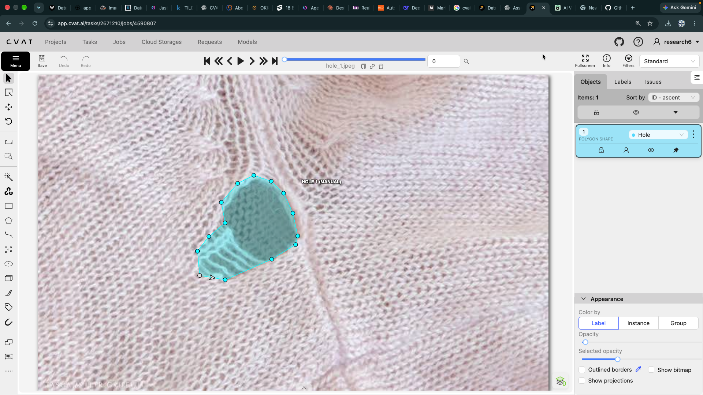
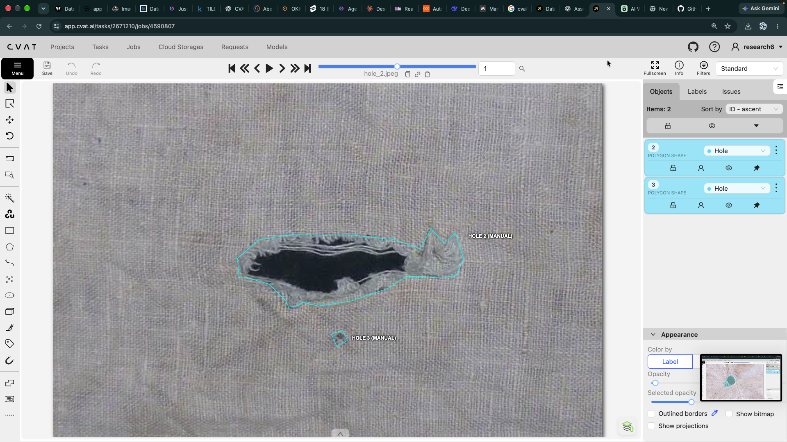
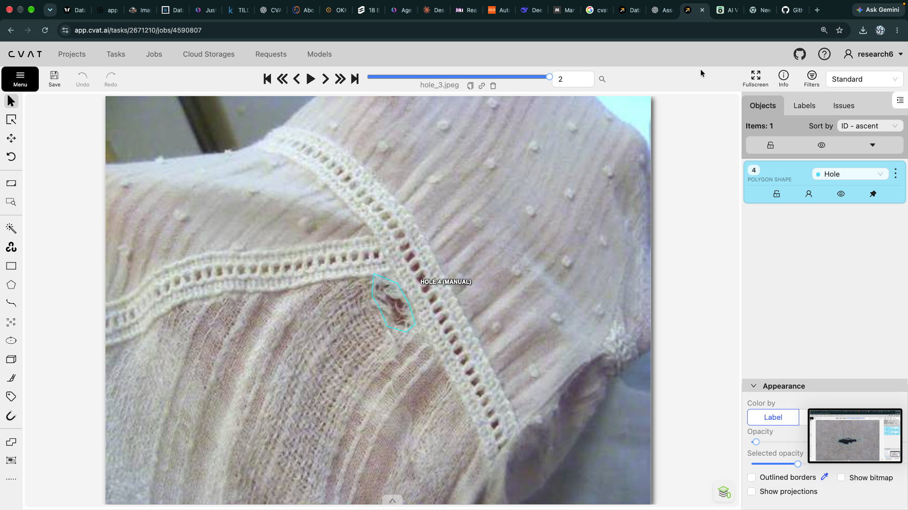
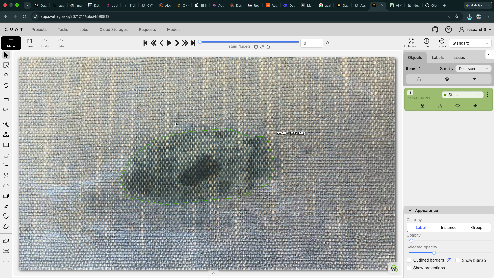
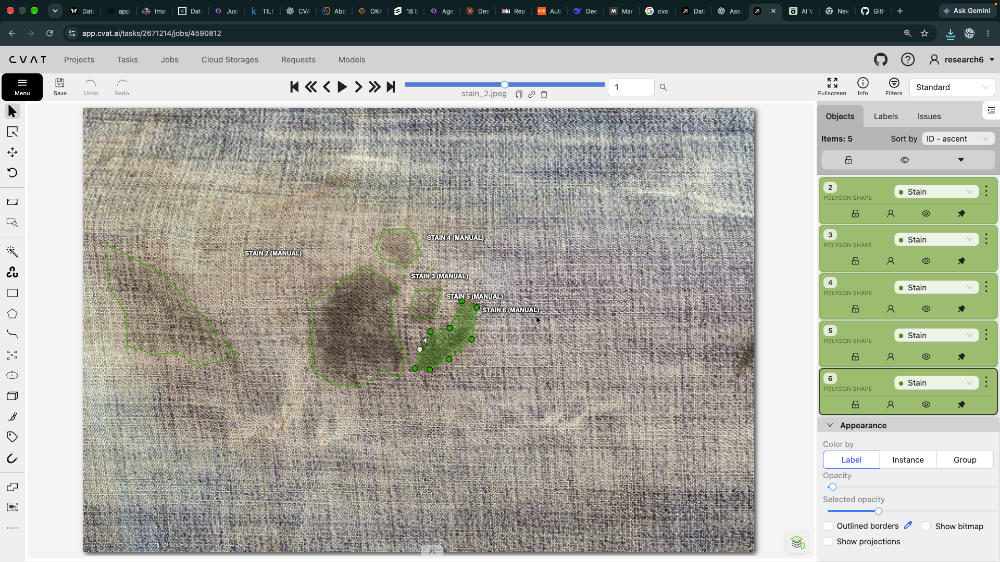
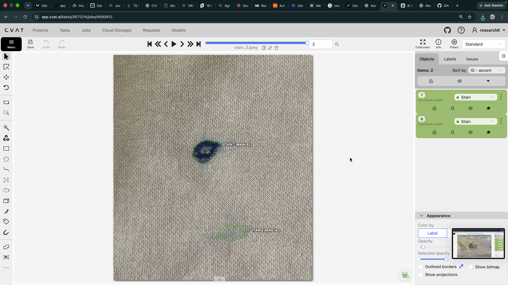
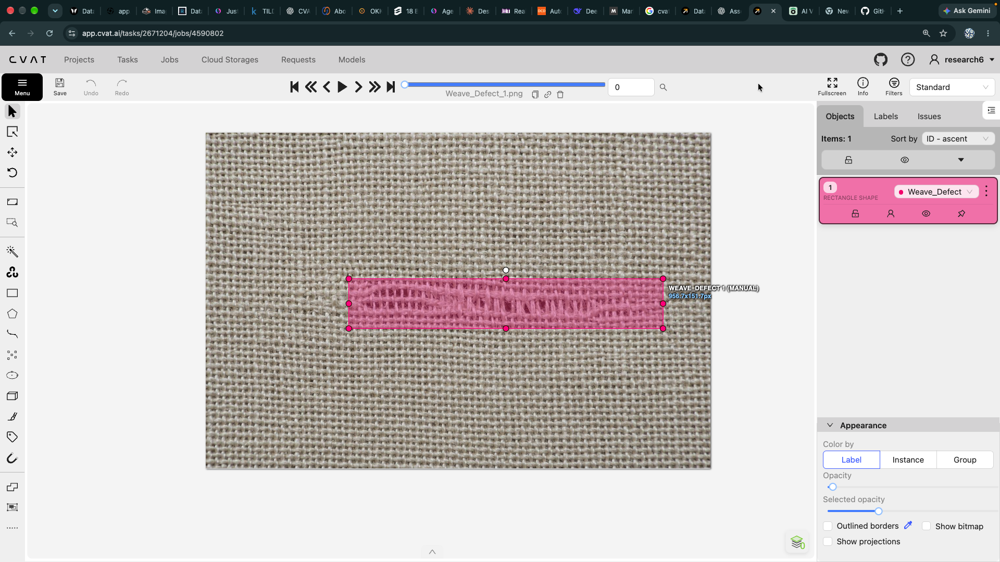
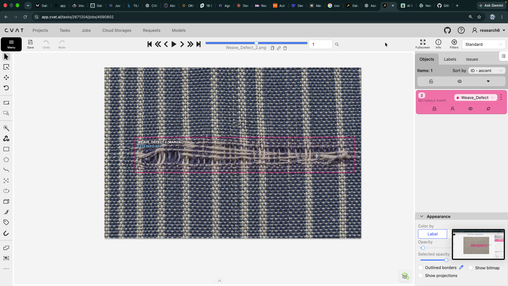
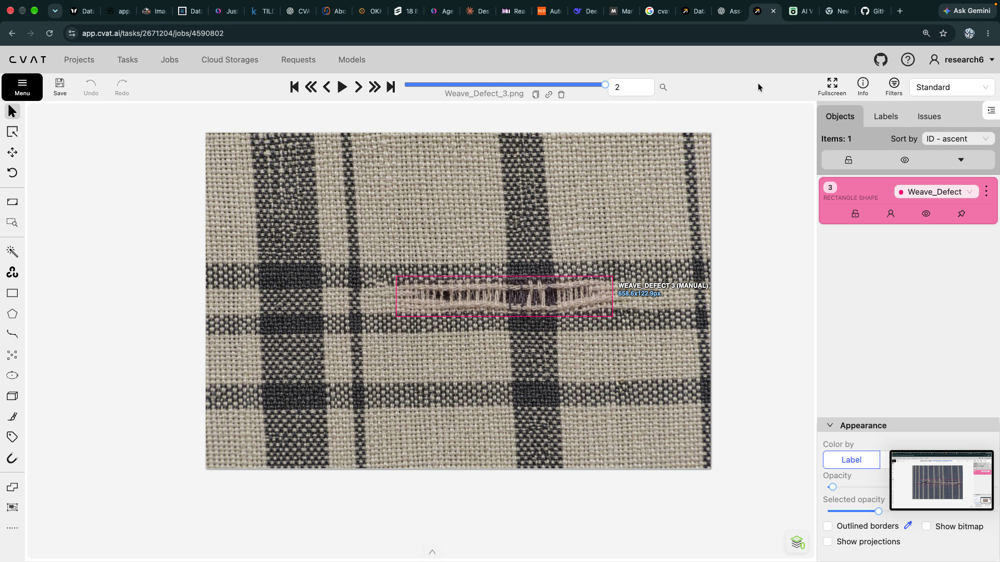

# Textile Defect Annotation Portfolio

A compact **CVAT annotation portfolio** featuring manually labeled textile defects. The samples demonstrate polygon and bounding-box workflows on fabric images.

## Portfolio at a glance

| Task | Images | Annotation type | Labeled objects |
| --- | ---: | --- | ---: |
| Hole defect | 3 | Polygon | 4 |
| Stain defect | 3 | Polygon | 8 |
| Weave defect | 3 | Bounding box | 3 |
| **Total** | **9** | — | **15** |

Labels are `Hole`, `Stain`, and `Weave_Defect`. The original CVAT task exports included a broader label list; each sample here contains only its task's relevant label.

## Annotation preview gallery

These previews show the labeled samples inline. Open the README on GitHub or another Markdown viewer to inspect them without opening the dataset folders.

### Hole defects · polygons

| Sample 1 | Sample 2 | Sample 3 |
| --- | --- | --- |
|  |  |  |

### Stain defects · polygons

| Sample 1 | Sample 2 | Sample 3 |
| --- | --- | --- |
|  |  |  |

### Weave defects · bounding boxes

| Sample 1 | Sample 2 | Sample 3 |
| --- | --- | --- |
|  |  |  |

## Folder layout

```text
.
├── README.md
└── datasets/
    ├── hole-defect/
    │   ├── annotations.xml
    │   ├── hole_1.jpeg ... hole_3.jpeg
    │   └── hole_1_annotated.png ... hole_3_annotated.png
    ├── stain-defect/
    │   ├── annotations.xml
    │   ├── stain_1.jpeg ... stain_3.jpeg
    │   └── stain_1_annotated.png ... stain_3_annotated.png
    └── weave-defect/
        ├── annotations.xml
        ├── weave_defect_1.png ... weave_defect_3.png
        └── weave_defect_1_annotated.png ... weave_defect_3_annotated.png
```

### Naming and file guide

- Folder names use lowercase kebab-case: `hole-defect`, `stain-defect`, `weave-defect`.
- Source image names use lowercase snake_case and preserve the original image extension.
- `*_annotated.png` files are visual annotation previews; use the original source images with `annotations.xml` for annotation data.
- `annotations.xml` is a CVAT for Images 1.1 annotations export for the corresponding three-image task. The annotation geometry and source image names are preserved. Personal owner details and CVAT task/job identifiers were removed from export metadata for portfolio sharing.

## Annotation approach

- **Holes:** polygon outlines follow the visible opening or damaged area.
- **Stains:** polygon outlines capture visible stain regions; separate regions are separate shapes.
- **Weave defects:** rectangular boxes mark the visible defect area.
- Annotations are manual (`source="manual"`) and use the CVAT label names shown above.

## Open or import in CVAT

1. Create a new **Task** in CVAT for the chosen defect folder.
2. Upload the original images from that folder (do not upload the `_annotated.png` previews as source data).
3. Create the matching label (`Hole`, `Stain`, or `Weave_Defect`) if CVAT prompts for labels.
4. Import `annotations.xml` into the task using CVAT's annotation upload/import action.
5. Check the annotations against the displayed images after import.

Each XML export is associated with the three matching source images in its folder. CVAT task IDs are not needed to reuse the annotation geometry.

## Scope

These are practice samples for demonstrating image annotation, class consistency, polygon segmentation, and object localization. They are a small portfolio sample, not a benchmark or production-ready dataset. Review image licensing and annotation quality before external or commercial reuse.

## Suggested portfolio summary

> Annotated textile defects in CVAT across hole, stain, and weave-defect classes. Created polygon annotations for irregular regions and bounding boxes for weave defects, with CVAT XML exports and visual previews for review.
